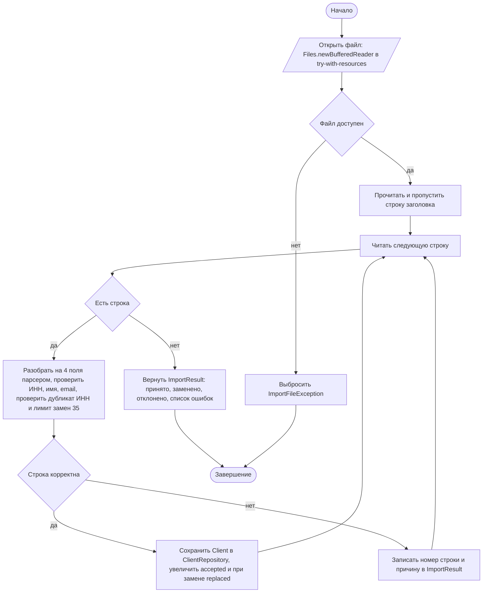
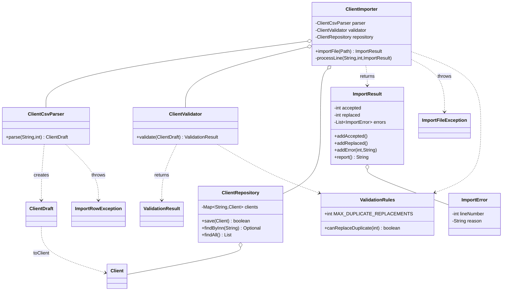

# Практическая работа №11. Файлы, исключения, пакетный импорт

Вариант 6 (две последние цифры зачётки 61: 61 mod 8 = 5, плюс 1 = 6). Изменяемый аспект: политика дубликатов, значение 35.

Запуск:

    mkdir out
    javac -encoding UTF-8 -d out src/clients/*.java
    java -cp out clients.SelfCheck
    java -cp out clients.Main data/sample.csv

## Формат файла

Первая строка - заголовок. Далее строки вида `inn;name;email;phone`, разделитель точка с запятой. Пустые строки пропускаются, но в нумерации учитываются. Телефон необязателен и не проверяется.

## Структура

- Client - принятая карточка клиента
- ClientDraft - сырые поля одной строки с её номером
- ClientCsvParser - делит строку на поля (ImportRowException при неверном числе полей)
- ClientValidator - проверяет ИНН, имя, email, собирает все причины в ValidationResult
- ValidationRules - числа правил и метод canReplaceDuplicate
- ClientRepository - Map клиентов по ИНН, поиск findByInn
- ImportResult, ImportError - принято, заменено, отклонено, список ошибок с номерами строк
- ClientImporter - читает файл и координирует разбор, проверку, сохранение
- ImportFileException (проверяемое, ошибка файла), ImportRowException (проверяемое, ошибка строки)
- SelfCheck - 19 проверок, Main - запуск

## Правила

- ИНН: только цифры, длина 10 или 12.
- Email: ровно один @, слева и справа непустые части.
- Имя клиента не пустое.
- Вариант 6, политика дубликатов, значение 35: если корректная запись имеет ИНН, который уже импортирован, она заменяет прежнюю (побеждает последняя). Замен допускается не более 35 за один импорт, 36-й и следующие дубликаты отклоняются с причиной. Некорректный дубликат прежнюю запись не заменяет.
- Ошибка строки записывается с номером и причиной, импорт продолжается. Ошибка открытия или чтения файла завершает импорт целиком.

## Ответы на вопросы задания

**Ошибка во фрагменте.** Весь цикл по строкам завёрнут в один try, а catch (Exception e) просто делает return. Первая же плохая строка прерывает цикл, все следующие корректные клиенты не импортируются, а причину никто не узнает: исключение проглочено, нет ни номера строки, ни отчёта. Это нарушает правило "ошибка одной строки не останавливает импорт". В проекте обработка строки вынесена в processLine, плохая строка записывается в ImportResult.addError, и цикл продолжается. Ошибка открытия файла обрабатывается отдельно и только как IOException.

**Почему Files.newBufferedReader.** Он читает файл построчно и не загружает весь файл в память, в try-with-resources сам закрывается, а номер строки удобно считать счётчиком в цикле. readAllLines проще, но держит в памяти весь файл целиком.

**Вариант и правило.** Вариант 6, политика дубликатов, значение 35. Реализовано так: повторная корректная запись с тем же ИНН заменяет прежнюю, но не более 35 замен за импорт. Число 35 хранится в ValidationRules.MAX_DUPLICATE_REPLACEMENTS, решение принимает ValidationRules.canReplaceDuplicate, применяет ClientImporter.processLine.

**Какая проверка защищает от наиболее вероятной ошибки входных данных.** Проверка числа полей в ClientCsvParser.parse и проверка ИНН в ClientValidator.checkInn: повреждённая строка чаще всего имеет лишние или недостающие разделители, или ИНН неправильной длины. Такая строка отклоняется с номером и причиной и не попадает в репозиторий.

**Где ключевое бизнес-правило и почему.** Правила допустимости клиента находятся в ClientValidator, а числа правил и политика дубликатов в ValidationRules. Парсер не должен знать, что считается корректным, а импортёр только координирует, поэтому правила собраны в одном классе и меняются без правки остальных.

**Как Activity-диаграмма отражает код.** Цикл "Читать следующую строку - Есть строка - Разобрать и проверить - Строка корректна - Сохранить Client или Записать ошибку строки - снова Читать" это while в ClientImporter.importFile и метод processLine: parser.parse, validator.validate, проверка дубликата, repository.save и result.addAccepted, addReplaced или addError. Ветка "нет строки" ведёт к возврату ImportResult, ветка "файл недоступен" к ImportFileException.

**Какое изменение затронет минимум классов.** Изменение лимита замен дубликатов (или длины ИНН): правится константа в ValidationRules. Остальные классы используют метод canReplaceDuplicate и значения не знают.

## Граничные проверки (результат SelfCheck)

| Проверка | Результат |
| --- | --- |
| ИНН 10 и 12 цифр принимаются | PASS |
| ИНН 9, 11, 13 цифр отклоняются | PASS |
| ИНН с буквами, пробелом, минусом | PASS |
| email: нет @, два @, пустая левая или правая часть | PASS |
| дубликат ИНН заменяет прежнюю запись | PASS |
| дубликаты: 35 замен разрешено, 36-я отклонена | PASS |
| некорректный дубликат не заменяет прежнюю запись | PASS |
| пустые поля, неверное число полей | PASS |
| после ошибки импорт продолжается, номера строк верны | PASS |
| файл не найден, путь null, пустой файл, неверная кодировка | PASS |

## Результат запуска на data/sample.csv

    Принято: 4 (из них заменили прежнюю запись с тем же ИНН: 1)
    Отклонено: 5
    Строка 5: ИНН должен содержать 10 или 12 цифр, получено 5
    Строка 7: Email должен содержать ровно один символ @
    Строка 8: Email должен иметь непустые части слева и справа от @
    Строка 9: Имя клиента не указано
    Строка 10: Ожидалось 4 поля, получено 1

## Activity-диаграмма (обновлённая)

## Диаграмма классов (обновлённая)

